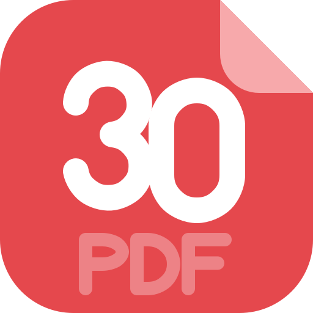
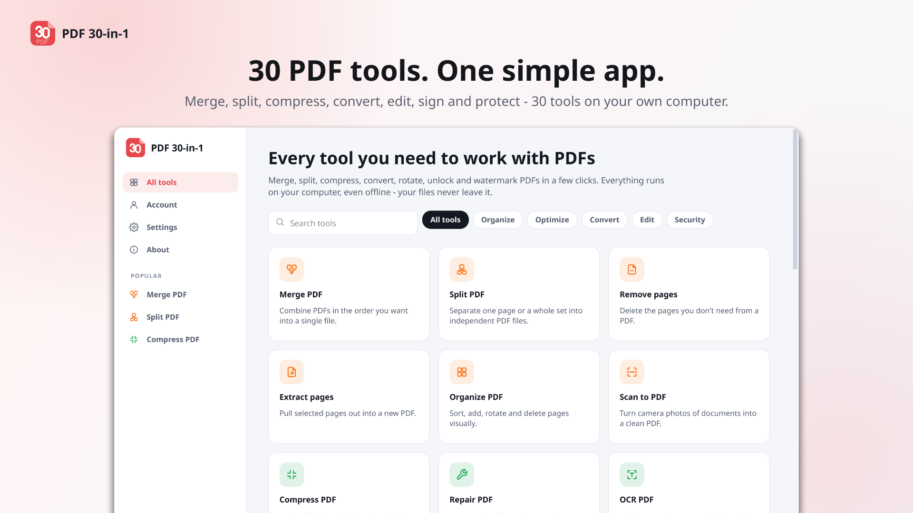
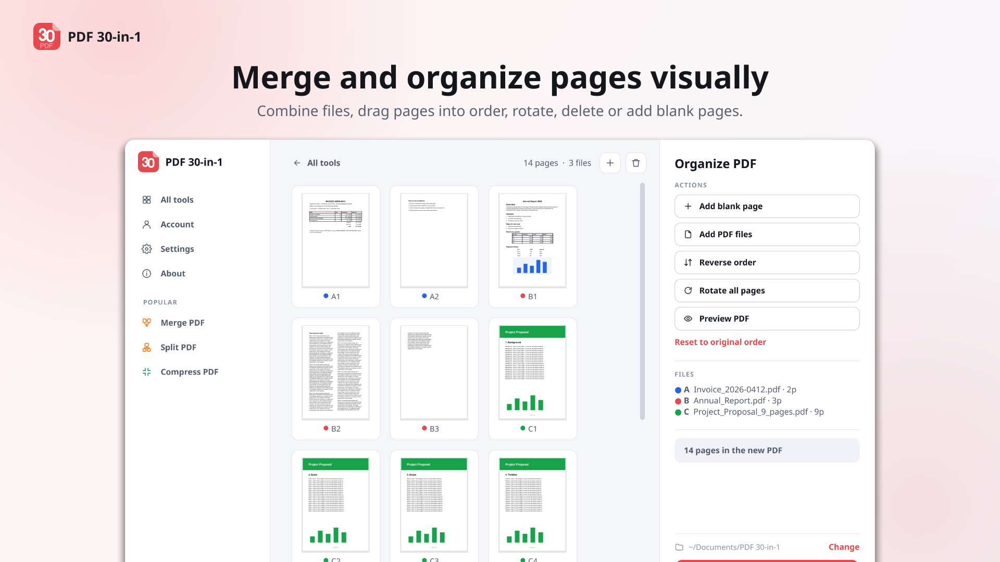
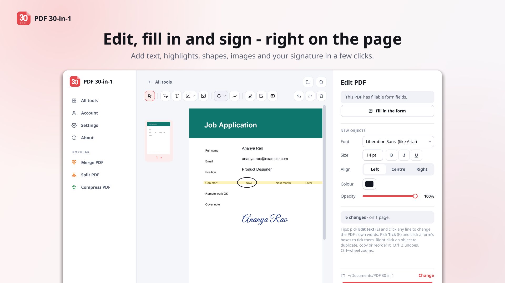
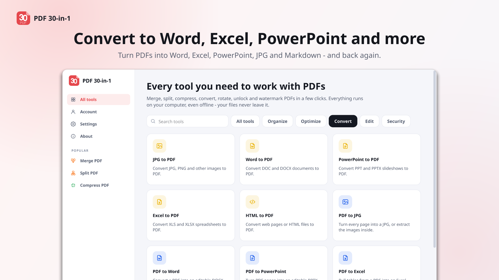
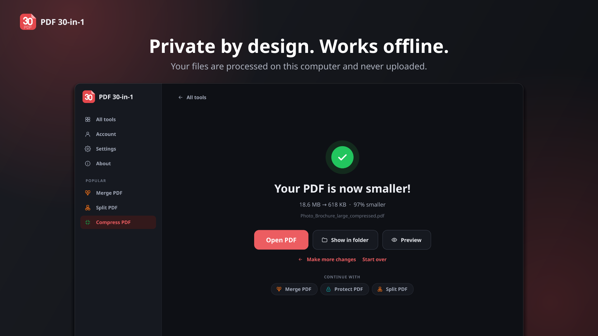

<h1 align="center">
  <br>
  PDF 30-in-1: Offline PDF Editor and Converter for Linux
</h1>

<p align="center">
  <b>31 PDF tools in one desktop app. Merge, split, compress, convert, edit, OCR and sign PDF files on your own computer.</b><br>
  No uploads, no sign-up, no watermarks. Works offline on Ubuntu, Fedora, Debian, Linux Mint, Arch and any other Linux.
</p>

<p align="center">
  <a href="https://snapcraft.io/pdf-30-in-1"></a>
  <a href="https://github.com/rishabh3354/PDF-30-IN-1/releases/latest"></a>
  <a href="https://github.com/rishabh3354/PDF-30-IN-1/releases"></a>
  
  
</p>

<p align="center">
  <a href="https://snapcraft.io/pdf-30-in-1"></a>&nbsp;
  <a href="https://flathub.org/apps/com.warlordsoftwares.pdf-30-in-1"></a>&nbsp;
  <a href="https://github.com/rishabh3354/PDF-30-IN-1/releases/latest"></a>
</p>

<p align="center">
  
</p>

**PDF 30-in-1** is an all-in-one **PDF editor, PDF converter and PDF toolkit for Linux**. It does what online
sites like iLovePDF, Smallpdf and PDF24 do, and much of what Adobe Acrobat does, but every file stays on your
computer. Merge PDFs, compress large PDFs for e-mail, convert **PDF to Word**, Excel and PowerPoint (and back),
make scanned PDFs searchable with **OCR**, edit PDF text, fill in forms and **sign PDFs**, all without an
internet connection.

## Contents

- [Why PDF 30-in-1](#why-pdf-30-in-1)
- [Install](#install-on-linux)
- [All 31 PDF tools](#all-31-pdf-tools)
- [Screenshots](#screenshots)
- [Free and PRO](#free-and-pro)
- [FAQ](#frequently-asked-questions)
- [Support](#support-and-feedback)

## Why PDF 30-in-1

- **Private by design.** Your PDFs are processed on your own computer and never uploaded. Safe for contracts,
  bank statements, ID scans, medical records and anything else you wouldn't put on a website.
- **Works offline.** On a plane, behind a company firewall or with no connection at all, every tool still works.
- **31 tools, one app.** No more switching between a PDF merger, a PDF compressor, an OCR program and an online
  converter. Everything has the same simple flow: choose files, pick options, done.
- **No limits on file size, no queues, no watermarks.** Big scanned documents are processed at the speed of your
  own computer.
- **Office conversions that keep the layout.** Word, Excel and PowerPoint to PDF, and PDF back to editable DOCX,
  XLSX and PPTX. The Snap and Flatpak versions include everything needed, so there's nothing extra to install.
- **OCR in over 100 languages.** Turn scans and photos into searchable, selectable PDF text.
- **Easy to use.** Drag and drop files, see a live page preview, light and dark themes, touchscreen support, and an
  interface in 20 languages.

## Install on Linux

### Snap (Ubuntu and most distributions)

```bash
sudo snap install pdf-30-in-1
```

Or open **Ubuntu Software** / **App Center**, search for *PDF 30-in-1* and click Install.

### Flatpak (Fedora, Linux Mint, Pop!_OS, elementary OS, Arch and more)

```bash
flatpak install flathub com.warlordsoftwares.pdf-30-in-1
```

### AppImage (any Linux, no installation)

1. Download `PDF-30-in-1-x86_64.AppImage` from the [latest release](https://github.com/rishabh3354/PDF-30-IN-1/releases/latest).
2. Make it executable and run it:

```bash
chmod +x PDF-30-in-1-x86_64.AppImage
```

```bash
./PDF-30-in-1-x86_64.AppImage
```

The AppImage uses LibreOffice, Tesseract and Ghostscript from your system for Office conversions, OCR and PDF/A.
Install them with your package manager if you need those tools; the Snap and Flatpak already include them.

### Windows

A Windows 10 and 11 version is coming. Click **Watch → Custom → Releases** at the top of this page to get notified.

## All 31 PDF tools

### Organize PDF

| Tool | What it does |
| --- | --- |
| **Merge PDF** | Combine several PDF files into one, in any order. |
| **Split PDF** | Split a PDF by page ranges, every few pages, or by file size for e-mail. |
| **Remove pages** | Delete the pages you don't need from a PDF. |
| **Extract pages** | Pull selected pages out into a new PDF. |
| **Organize PDF** | Sort, add, rotate and delete pages visually with drag and drop. |
| **Scan to PDF** | Turn phone photos of documents into a clean, straight PDF. |

### Optimize PDF

| Tool | What it does |
| --- | --- |
| **Compress PDF** | Reduce PDF file size while keeping text sharp. |
| **Repair PDF** | Recover data from a damaged or corrupt PDF file. |
| **OCR PDF** | Make scanned PDFs searchable and selectable, in over 100 languages. |

### Convert to PDF

| Tool | What it does |
| --- | --- |
| **JPG to PDF** | Convert JPG, PNG and other images to PDF. |
| **Word to PDF** | Convert DOC and DOCX documents to PDF. |
| **Excel to PDF** | Convert XLS and XLSX spreadsheets to PDF. |
| **PowerPoint to PDF** | Convert PPT and PPTX slideshows to PDF. |
| **HTML to PDF** | Save any web page or HTML file as a PDF that looks like it does in the browser. |

### Convert from PDF

| Tool | What it does |
| --- | --- |
| **PDF to Word** | Convert a PDF into an editable DOCX document. |
| **PDF to Excel** | Pull tables from a PDF into an Excel spreadsheet. |
| **PDF to PowerPoint** | Turn PDF pages into an editable PPTX slideshow. |
| **PDF to JPG** | Turn every page into a JPG, or extract the images inside a PDF. |
| **PDF to PDF/A** | Convert to PDF/A for long-term archiving. |
| **PDF to Markdown** | Turn a PDF into clean Markdown with headings, lists and tables. |

### Edit PDF

| Tool | What it does |
| --- | --- |
| **Edit PDF** | Change the PDF's own text, and add text, highlights, shapes, images and drawings. |
| **PDF Forms** | Fill in a PDF form, or make a PDF fillable with text fields, checkboxes and choices. |
| **Rotate PDF** | Rotate single pages or whole documents. |
| **Add page numbers** | Number your pages with the position and style you want. |
| **Add watermark** | Stamp text or an image over your pages. |
| **Crop PDF** | Trim the margins or a chosen area of your pages. |

### PDF security

| Tool | What it does |
| --- | --- |
| **Sign PDF** | Sign with a drawn, typed or uploaded signature, or with a digital certificate (.p12 / .pfx). |
| **Protect PDF** | Encrypt a PDF with a password (AES-256). |
| **Unlock PDF** | Remove the password from a PDF you can open. |
| **Redact PDF** | Permanently black out sensitive text and areas. |
| **Compare PDF** | See the differences between two versions side by side. |

## Screenshots

<p align="center">
  
  
  
  
</p>

## Free and PRO

- **Free:** every tool, 3 tasks a day, no watermarks on your files.
- **PRO:** unlimited tasks with a one-time payment, or a 1-month or 3-month plan.
  See [plans and pricing](https://warlordsoftwares.com/apps/plans-and-pricing/?product=PDF30IN1).

## Languages

English, العربية, Deutsch, Español, Français, हिन्दी, Bahasa Indonesia, Italiano, 日本語, 한국어, Nederlands, Polski,
Português (Brasil), Русский, Svenska, ไทย, Türkçe, Українська, Tiếng Việt and 简体中文. The app follows your
computer's language, and you can change it in Settings.

## Frequently asked questions

### Is PDF 30-in-1 a good offline alternative to iLovePDF, Smallpdf or PDF24?

Yes. It covers the same everyday tools (merge, split, compress, convert, OCR, sign, protect) as a desktop app,
so your documents are never uploaded to someone else's server and you don't need an internet connection.

### Is it an Adobe Acrobat alternative for Linux?

Acrobat isn't available for Linux. PDF 30-in-1 gives Linux users PDF editing, form filling, signing (including
digital certificates), OCR, redaction and PDF to Word conversion in one app.

### Are my files uploaded anywhere?

No. Every tool runs on your own computer. The only tool that uses the internet is HTML to PDF, and only when you
type a web address to convert.

### How do I merge PDF files on Linux?

Open PDF 30-in-1, choose **Merge PDF**, drop in your files, drag them into the order you want and click Merge.

### How do I compress a PDF on Linux without losing quality?

Choose **Compress PDF**, pick Extreme, Recommended or Less compression and save. Text and vector graphics stay
sharp at every level; only photos are re-encoded, and your original file is never changed.

### Can I convert PDF to Word on Linux?

Yes. **PDF to Word** creates an editable DOCX file that opens in LibreOffice Writer, Microsoft Word, Google Docs
and OnlyOffice. For scanned PDFs, run **OCR PDF** first.

### Can I sign a PDF with a digital certificate?

Yes. **Sign PDF** accepts .p12 and .pfx certificates, as well as drawn, typed and image signatures.

### Which Linux distributions are supported?

Any 64-bit (x86_64) Linux with Snap, Flatpak or AppImage support, including Ubuntu, Fedora, Debian, Linux Mint,
Pop!_OS, elementary OS, Zorin OS, Manjaro, Arch Linux and openSUSE.

## Support and feedback

- Found a bug or want a new tool? [Open an issue](https://github.com/rishabh3354/PDF-30-IN-1/issues).
- Questions about PRO or your account: [contact us](https://warlordsoftwares.com/contact-us/).
- If PDF 30-in-1 saves you time, please **⭐ star this repository** and leave a review on the
  [Snap Store](https://snapcraft.io/pdf-30-in-1). It helps other people find the app.

---

<p align="center">
  Made by <a href="https://warlordsoftwares.com">Warlord Softwares</a> ·
  <a href="https://warlordsoftwares.com/trending-apps/pdf-30-in-1-offline-pdf-editor-and-converter/">Website</a> ·
  <a href="share/license/LICENSE">License</a>
</p>

<sub>The Snap and Flatpak versions include Tesseract (OCR), Ghostscript (PDF/A) and LibreOffice (Office
conversions), each under its own licence. iLovePDF, Smallpdf, PDF24 and Adobe Acrobat are trademarks of their
respective owners; PDF 30-in-1 is not affiliated with them.</sub>
